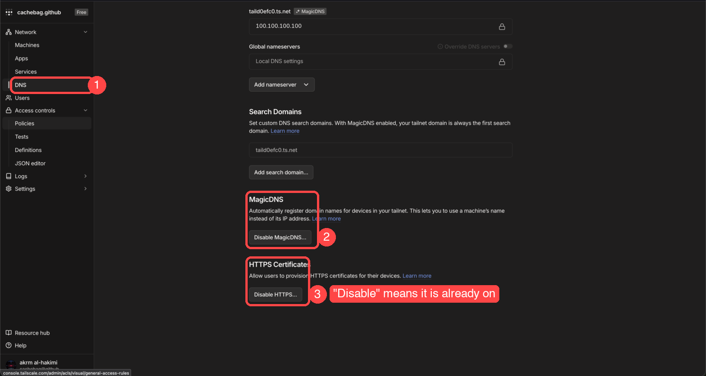
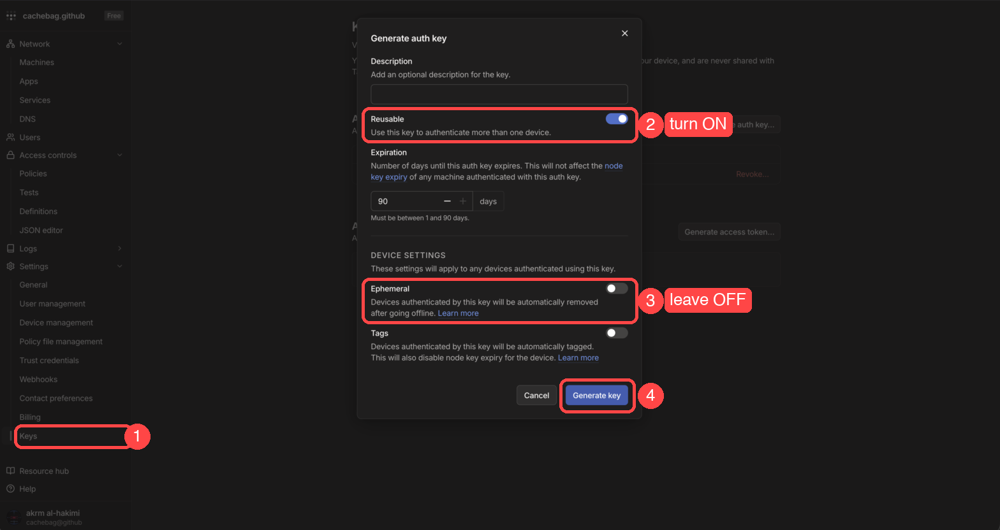
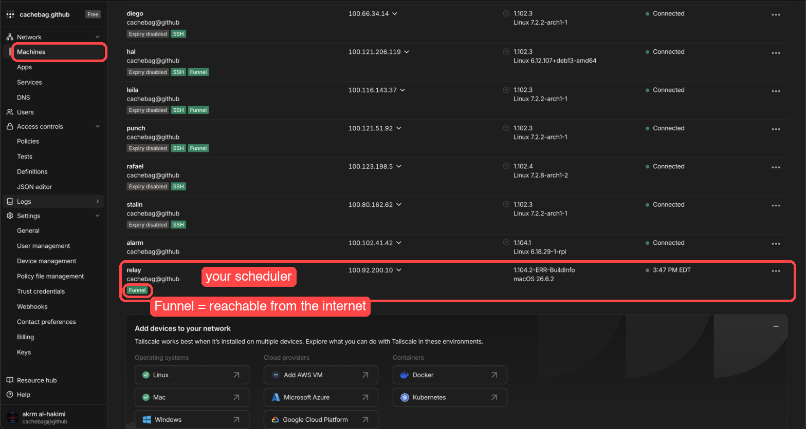

# Put your scheduler on the internet

`relayd --public` gives your scheduler a public `https://` address through Tailscale. Contributors anywhere can join your pool, and they install nothing extra. You don't open ports, buy a domain, or set up certificates. Only you need a Tailscale account, and the free plan is enough.

Setup takes about five minutes the first time, and everything after that is just one command.

**Is this safe?** Yes. Nothing on your machine is opened up except relayd itself, and every relayd route needs a token: the join token for pool members, the admin token for admin actions. Strangers who find the address get turned away on every request. Traffic is HTTPS, contributors never join your tailnet, and your other Tailscale machines stay invisible to them.

## 1. Make a Tailscale account

Sign up at https://login.tailscale.com with GitHub, Google, or any other option. You don't need the Tailscale app for this. Your tailnet gets a name like `taild0efc0.ts.net`, and your scheduler's address will be `https://relay.<that name>`.

## 2. Check DNS settings

In the admin console, click **DNS** in the sidebar (1) and scroll down. **MagicDNS** (2) and **HTTPS Certificates** (3) both need to be on. If a button says "Disable", that one is already on. If it says "Enable", click it.



## 3. Make an auth key

Click **Keys** in the sidebar (1), then **Generate auth key**. In the dialog:

- **Reusable** on (2). Without it the key works once and `relayd` can't restart.
- **Ephemeral** off (3). Otherwise your scheduler's address changes every run.
- Leave expiry at 90 days and Tags off. Click **Generate key** (4).



Copy the key. It starts with `tskey-auth-` and is shown only once. Treat it like a password: anyone with it can add machines to your tailnet.

## 4. Run relayd

With the CLI (`relay install` first, if you haven't):

```sh
relay scheduler start --public
```

It asks for the auth key once and keeps it, starts `relayd` in the background, saves the server admin token so `relay pool create` and the dashboard never ask for it, and prints the public address:

```text
relayd running (pid 12345)
  local address:   http://localhost:8080
  public address:  https://relay.taild0efc0.ts.net
  server admin token saved; relay pool create and the dashboard use it
```

`relay scheduler status` shows the same later, and `relay scheduler stop` stops it. The log is `relayd.log` in your relay config folder.

Running `relayd` by hand works too, with the key in the environment: `TS_AUTHKEY=tskey-auth-... ./relayd --public` (PowerShell: `$env:TS_AUTHKEY="..."; .\relayd.exe --public`). It prints the server admin token on first start, then the public address line.

If the log instead shows a link about enabling Funnel, open it, click **Enable**, and run `relay scheduler stop` then `start --public` again. That's a one-time switch for your tailnet.

Back in the admin console, **Machines** now lists a node named `relay` with a Funnel badge. That's your scheduler. Leave it there; it's what keeps the address the same between runs.



## 5. Make a pool and invite people

Use the public address as the scheduler:

```sh
relay --scheduler https://relay.taild0efc0.ts.net pool create my-pool --admin-token <server admin token>
```

The last line it prints is the exact command contributors run. Send it to them:

```text
relay-agent --scheduler https://relay.taild0efc0.ts.net --pool-token <join token>
```

You can also run `relay pool create my-pool` against `localhost` on the machine running relayd. relayd knows its public address, so the invite still has the `https://….ts.net` address and needs no editing. `relay pool rotate-token` does the same.

Log in yourself so every other command uses the public address too:

```sh
relay login --scheduler https://relay.taild0efc0.ts.net --pool-token <join token>
relay nodes
```

## Good to know

- `--name` picks the hostname. For instance: `relayd --public --name lab` gets `https://lab.<tailnet>.ts.net`.
- The plain `:8080` listener stays up, so machines on your LAN can keep using `http://<your-ip>:8080`.
- Tailscale state lives in `relay/tsnet` under your user config directory. Delete that folder to start over with a fresh node.
- Funnel has a bandwidth cap. Fine for heartbeats and job output, which is capped at 1 MB. Not for moving big files.
- `relayd --public` uses `TS_AUTHKEY` first, then the key saved by the CLI. If neither is available, it exits with code 2 and says what to set.